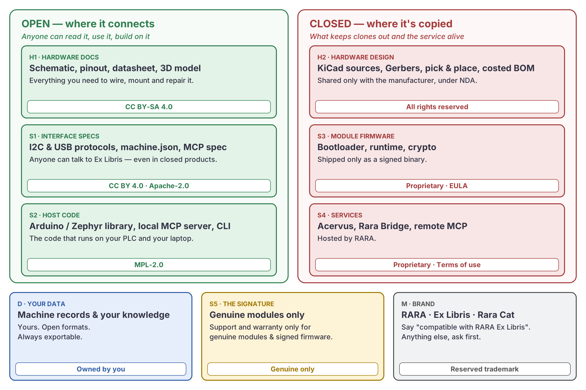

# Licensing

RARA PLC is licensed **by layer**: open where it connects, closed where it's copied.
We publish what an integrator needs to trust, wire, repair and integrate. We keep closed what would let someone clone the module, and what runs the service.



## Layers

| # | Layer | What it includes | License | Published here |
|---|---|---|---|---|
| H1 | **Hardware docs** | Ex Libris schematic (PDF), pinout, datasheet, 3D model and mechanical drawings, block diagram | [CC BY-SA 4.0](https://creativecommons.org/licenses/by-sa/4.0/), provided as a reference design **AS IS**, without warranty | Yes, when released |
| H2 | **Hardware design files** | KiCad sources, custom footprints and symbols, Gerbers, pick & place, sourced BOM | All rights reserved. Shared only with the manufacturer, under NDA | No |
| S1 | **Interface specs** | I2C and USB CDC protocols, `machine.json` schema, MCP server spec | Text: [CC BY 4.0](https://creativecommons.org/licenses/by/4.0/). Schemas and examples: [Apache-2.0](https://www.apache.org/licenses/LICENSE-2.0). Anyone can implement them, even in closed products | Yes, when released |
| S2 | **Host code** | Arduino / Zephyr library for the host PLC, local MCP server, CLI and tools | [MPL-2.0](https://www.mozilla.org/en-US/MPL/2.0/). File-level copyleft: share changes to our files; your own files stay yours | Yes, when released |
| S3 | **Module firmware** | Bootloader, Ex Libris runtime, secure element handling | Proprietary. Distributed only as a signed binary, under an EULA | No |
| S4 | **Services** | Acervus, Rara Bridge, remote MCP | Proprietary. Hosted service under terms of use | No |
| S5 | **The signature** | Genuine modules and signed firmware | Support and warranty apply only to genuine modules running signed firmware | — |
| D | **Your data** | `machine.json`, logbook, program and documentation of your machine | **Yours**, the machine owner's. RARA only gets the limited rights needed to run the service. Always exportable in open formats | — |
| M | **Brand** | "RARA", "Ex Libris", Rara Cat | Reserved trademarks. Nominative use is fine ("compatible with RARA Ex Libris"); anything else, ask first | — |

## Rules that follow

1. **No strong copyleft in the module firmware.** It uses only permissive components (for example Zephyr and MCUboot under Apache-2.0, STM32 HAL/LL and LittleFS under BSD-3-Clause, heatshrink under ISC). Their notices ship in a NOTICE file.
2. **The schematic is published as a PDF** exported from KiCad, with the license in the title block. The `.kicad_sch` files are not published.
3. **Your data is portable.** You can take your machine records without going through RARA.

## This repository

| Content | License |
|---|---|
| README, `docs/` text and diagrams | CC BY 4.0 |
| Rara Cat and RARA logos (`docs/assets/rara-cat-*`, `docs/assets/rara_cat_logo.svg`) | Reserved trademark (layer M) |
| Future folders (`specs/`, `host/`, `hardware-docs/`) | The layer license above, stated again in a `LICENSE` file inside each folder |

Board silkscreen on every Ex Libris:

```
RARA EX LIBRIS  REV x.y
(c) 2026 RARA MACHINA - PCB DESIGN ALL RIGHTS RESERVED
SCHEMATIC & DOCS: CC BY-SA 4.0 - RARAPLC.IO
```
