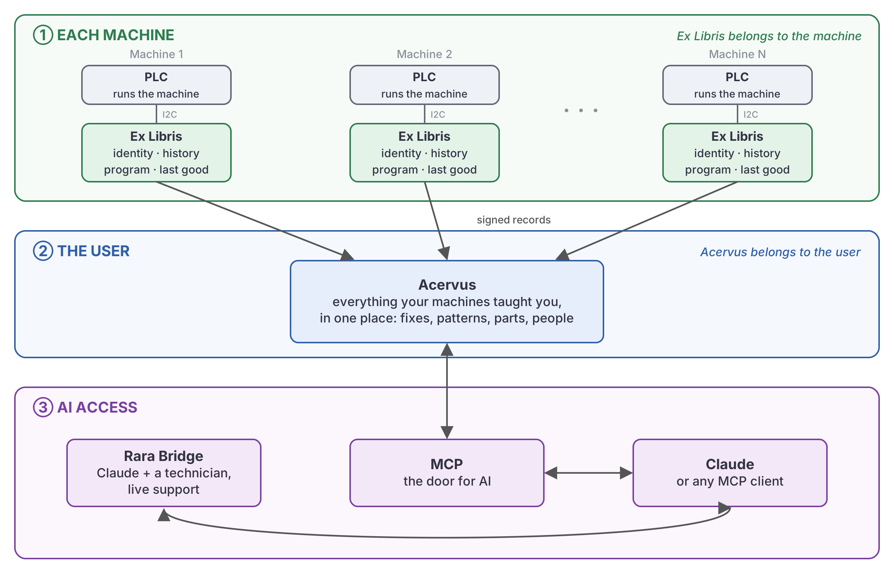
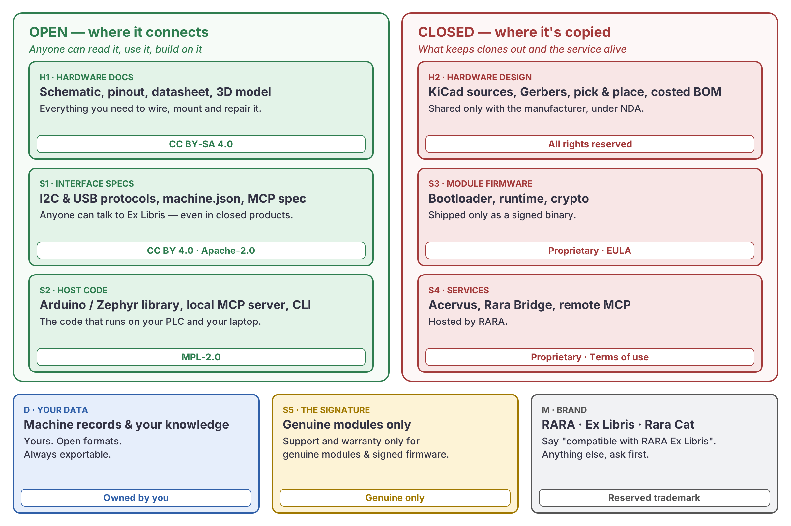

# RARA PLC

**Your machine works. Nobody remembers how.**

The integrator left. The docs are lost. The program on the PLC doesn't match any backup.
When the machine stops, someone starts from zero.

**RARA PLC is an intelligence suite for industrial PLCs.**
It gives every machine a memory, an identity and an AI that can read both.

> **Status:** design stage. No field units yet. Nothing below is a shipping product; it is what we are building, in the open.

## Highlights

- **Machine memory.** I/O map, wiring, program, contacts and history, stored with the machine.
- **Signed history.** Every change is signed on-chip. Tampering shows.
- **Always recoverable.** The last working version is kept, ready to restore.
- **Works when the PLC is dead.** Plug in a phone or laptop and read the record.
- **AI that knows your machine.** Claude reads the machine's own record, not generic manuals.
- **Outside the control loop.** Your PLC runs the same with or without RARA.
- **Your data stays yours.** Open formats, always exportable.
- **Open where it connects.** Schematics, protocols and host libraries are open.
- **Runs on real controllers.** Arduino Portenta Machine Control and Arduino Opta.

## The suite



| Component | What it does | Belongs to |
|---|---|---|
| **Ex Libris** | A small add-on module. It gives each machine a signed identity and its own logbook. | The machine |
| **Acervus** | Everything your machines taught you, in one place: fixes, patterns, parts, people. | The user |
| **MCP server** | Lets Claude, or any MCP-compatible AI client, talk to the machine's record. | — |
| **Rara Bridge** | Live support. Claude reads the machine's record and helps a technician diagnose it. | — |

## Ex Libris

*Ex libris*: the mark that tells you whose book this is. Here, it tells a machine who it is and where it comes from.

Ex Libris is the hardware piece of RARA PLC. It plugs into the PLC that already runs the machine, over **I2C**:

- **Arduino Portenta Machine Control:** the front Grove connector. No need to open the controller.
- **Arduino Opta:** the expansion port. Nothing to solder.

What it keeps:

- **Identity.** A secure element gives the module keys that cannot be extracted. Genuine modules can prove it.
- **History.** Every change to the logic: what, when, why and who asked. Signed, in the module's own non-volatile memory.
- **Last good version.** If a new program fails, the machine goes back to the one that worked.
- **A way in with the PLC off.** USB-C to read the record from a laptop or a phone.

What it never does: control outputs, take part in the scan cycle or touch any safety function. Writes from AI need a person at the machine, pressing a physical button.

<!-- EX-LIBRIS-RENDERS -->

## How AI fits in

Claude talks to Ex Libris through an **MCP server**, an open protocol for AI tools.

- **Read:** identity, I/O map, events, history. Verify that a snapshot is genuine.
- **Program:** the technician describes the behavior in plain language. Claude writes it as EARS requirements. The technician approves each one. Logic and tests are generated and stored as a *candidate*. Nothing loads until a person presses the presence button.
- **Local or remote:** on the technician's laptop over USB-C, offline, with the machine stopped; or remote, for a phone or for support at a distance.

The MCP server is specified. It is not implemented yet.

## What it is not

- Not a PLC replacement.
- Not part of the control loop or of any safety function.
- Not a cloud lock-in.

## Open where it connects, closed where it's copied

We publish everything an integrator needs to trust, wire, repair and integrate Ex Libris. We keep closed what would let someone clone it, and what runs the service.



Full table and rules: [`LICENSE.md`](LICENSE.md).

## Repository

```
docs/       Diagrams and brand assets
.github/    Issue and pull request templates
```

Interface specs (I2C, USB, `machine.json`, MCP) and host code will land here as they are released, each folder with its own license.

## Contributing

Ideas, questions and reviews are welcome: open an issue. See [`CONTRIBUTING.md`](CONTRIBUTING.md). This project follows the Contributor Covenant ([`CODE_OF_CONDUCT.md`](CODE_OF_CONDUCT.md)).

## About

Sponsored by Rara Machina, Buenos Aires. RARA PLC is an independent project. It is not affiliated with or endorsed by Arduino, Finder or Anthropic. Arduino, Opta and Portenta are trademarks of their owners.
